Original web-gui: https://dash0-migrator.vercel.app

Update: Expanded the functionalities of our web GUI to an actual CLI called **intern0**.



## Installation

Python 3.9 or later.

```
git clone -b feature/intern0 https://github.com/eric134422/dash0-dashboard-migrator
cd dash0-dashboard-migrator
uv tool install .          # or: pipx install .
intern0 migrate            # add --dry-run to only preview, nothing is sent
```

Without installing, run `python3 -m intern0 migrate` inside the folder.

The first run opens your browser twice: sign in to Datadog and later to Dash0. Click allow so the migrator can move dashboards and alerts.

## Files

```
pyproject.toml               makes intern0 an installable command
intern0-demo.svg             the picture above
intern0/
├── cli.py                   intern0: sign-ins, picking, plan, import
└── converter/
    ├── datadog_to_perses.py     Datadog dashboard → Dash0 dashboard (Perses)
    ├── monitors_to_dash0.py     Datadog monitor → Dash0 alert (Prometheus rule)
    └── datadog_metrics.csv.gz   type and unit of 36,948 Datadog metrics, used by both
```
